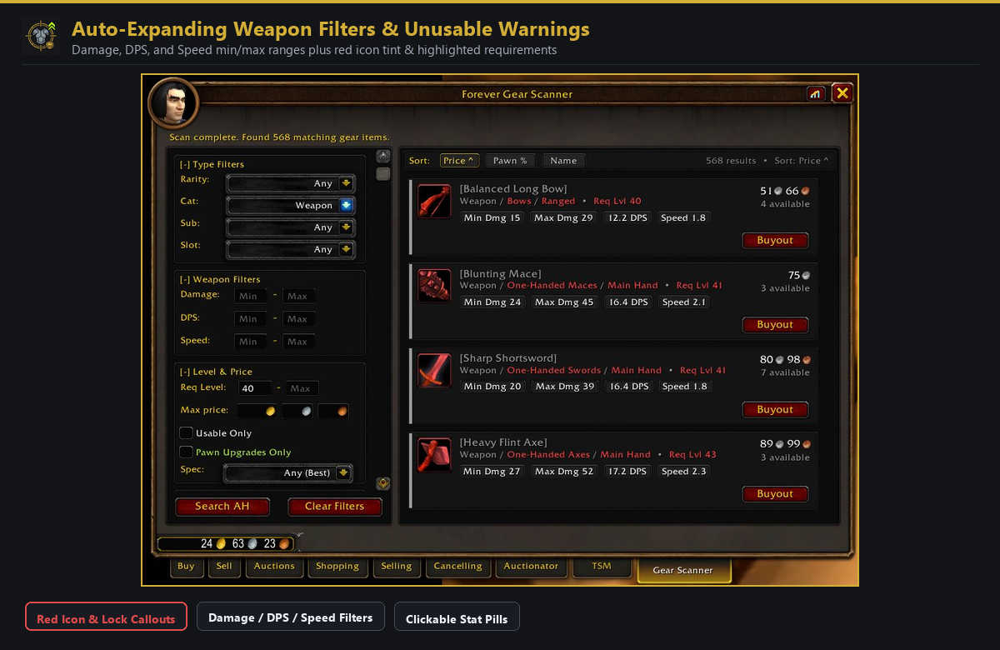

  

# Forever Gear Scanner

The default Auction House in **World of Warcraft: Forever** (`Interface: 16001`) only lets you browse by item name and price. If you want an upgrade with Spell Power, MP5, Hit, or a specific weapon speed, you end up hovering over dozens of listings one tooltip at a time.

**Forever Gear Scanner** adds a **Gear Scanner** tab to the Auction House and replaces tooltip hunting with scannable gear cards. Filter across 40 stats with min and max values, cap your Gold / Silver / Copper budget before scanning, spot unusable items at a glance, and see **Pawn** upgrade percentages right on the results.

## Feature Video

[Watch on YouTube](https://youtu.be/cQfqY-uiT_Q)

## What You Get

- **Scannable gear cards instead of tooltip hunting:** Every card shows item level, required level, weapon or armor type, slot, damage/DPS/speed, full stats, and available listing count. Browse queries target equipable **Weapon** and **Armor** items directly on `C_AuctionHouse`, so consumables, trade goods, and bags never clutter your search.
- **Live sort bar & quick pivots:** Sort results from the top bar (`Price`, `Pawn %`, `Name`) with live result counts, or left-click any stat or weapon pill (`Min Dmg`, `Max Dmg`, `DPS`, `Speed`, plus equip stats) to sort by that value - right-click a pill to add it to your Stat Filters.
- **Filter across 40 stats with min/max values:** Search for Spell Power, Healing, school spell damage (Fire, Frost, Shadow, Nature, Arcane, Holy), Crit, Hit, Haste, MP5, Expertise, Defense, Block Value, and primary stats. Click an empty `Stat...` box to browse the scrollable 40-stat dropdown or type to narrow it down.
- **Held in Off-Hand and auto-expanding weapon/armor filters:** Standard AH categories bury off-hand items under Miscellaneous armor. Forever Gear Scanner gives you direct **Held in Off-Hand** slot filtering, keeps **Weapon Filters** (`Damage`, `DPS`, `Speed`) and **Armour Filters** tucked neatly under `Any Equipment`, and auto-expands the matching section when you switch **Cat**.
- **Exact Gold / Silver / Copper price cap:** Set your max budget in coin boxes before scanning, and narrow results further by **Req Level**, **Rarity**, **Category**, **Subtype**, and **Slot**.
- **Unusable gear warnings:** If **Usable Only** is unchecked, items your character cannot equip tint red on the icon and highlight the missing proficiency, level, or class requirement directly on the card.
- **Safe 2-step buyout:** Clicking **Buyout** checks the cheapest live listing and switches the button to **Confirm Buy**. Nothing is bought until your second click.

## Screenshots

## Built to Pair with Pawn (Optional)

Forever Gear Scanner works on its own with no other addons required. If you also run **[Pawn](https://www.curseforge.com/wow/addons/pawn)** by **Vger**, the two integrate right inside the AH tab:

- **Upgrade badges on every card:** See the highest upgrade percentage and matching spec (such as `+21% Affliction`) next to the item name.
- **Spec-specific filtering and sorting:** Tick **Pawn Upgrades Only** and lock the **Spec** dropdown to a single spec, or keep it on `Any (Best)` and sort by biggest upgrade first. Switching specs re-filters and re-sorts current results live without re-scanning the AH.
- **Exact replacement tooltips:** Hover any green Pawn badge to see the equipped item it replaces.

Full credit to **Vger** for Pawn. Forever Gear Scanner reads your Pawn scales directly, so your AH searches use the same weights as your character sheet.

## Quick Start

1. Open any Auction House and click the **Gear Scanner** tab (or type `/fgs` or `/gearscanner`).
2. Set **Rarity**, **Cat** (`Weapon` or `Armor`), **Sub**, and **Slot**, plus optional **Req Level**, **Max price**, **Usable Only**, or **Pawn Upgrades Only**.
3. Click **+ Add Stat Filter** to pick stats and optional Min/Max thresholds.
4. Click **Search AH**.
5. Click **Buyout** on a card to check the live listing, then click **Confirm Buy** to purchase.

## Technical Notes

- **Target client:** World of Warcraft: Forever (`Interface: 16001`).
- **AH scanning & throttling:** Queries `C_AuctionHouse` item browse/search endpoints and gates queued requests against `IsThrottledMessageSystemReady()` so large scans stay throttle-safe.
- **Tooltip & stat parsing:** Combines base item stats with Classic/Forever `Equip:` tooltip parsing (including split healing + spell damage wording and weapon min/max damage, DPS, and speed).
- **Hardware-event buyout flow:** Clicking **Buyout** fetches live auction IDs asynchronously, then enables **Confirm Buy** so `PlaceBid` executes directly inside your second click (`#hwevent`).

## License

Released under the [MIT License](LICENSE).
