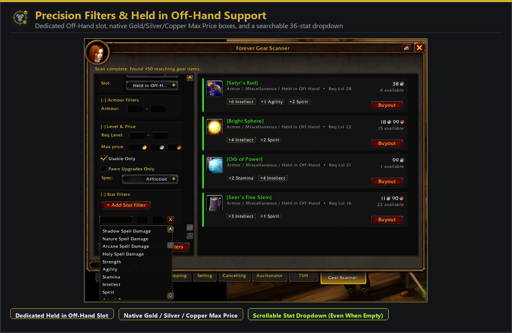
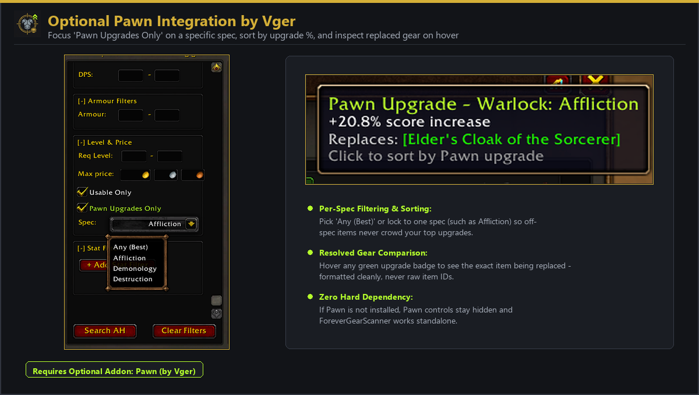

  

# ForeverGearScanner

A PoE2-inspired Auction House trade filter for **World of Warcraft: Forever** (`Interface: 16001`). Instead of clicking through dozens of AH pages looking for exact secondary stats or green upgrades, set your filters, hit **Search AH**, and scan gear cards side by side.

## Key Features

- **Gear-only server pre-filtering:** Browse queries target equipable **Weapon** and **Armor** items directly on Blizzard's `C_AuctionHouse` API - zero consumables, trade goods, or bags in your scan queue.
- **Dedicated Held in Off-Hand filter:** Pick **Held in Off-Hand** straight from the Slot dropdown without digging through Miscellaneous armor subcategories.
- **Multi-stat filtering with min/max thresholds:** Filter on specific stats such as `Spell Power`, `Healing`, school damage (`Fire`, `Frost`, `Shadow`, `Nature`, `Arcane`, `Holy`), `MP5`, `Crit`, `Hit`, `Haste`, `Expertise`, `Defense`, `Block Value`, and more. Click any empty stat box to scroll the full list or type to filter live.
- **Built for WoW: Forever stat wording:** Parses both raw stat lines and Classic/Forever `Equip:` sentences accurately (including split healing + spell damage items).
- **Throttle-safe AH queue:** Respects `IsThrottledMessageSystemReady()` and automatically resumes when the server clears throttles.
- **Unusable gear indicators:** Items you cannot equip tint soft red on the icon and highlight the failing restriction (proficiency, required level, or class lock) directly on the card.
- **Safe 2-click buyout:** Clicking **Buyout** queries the cheapest live auction first and switches to **Confirm Buy** - your second click confirms the purchase directly under hardware-event rules (`#hwevent`).

## Screenshots

## Optional Integration: Pawn by Vger

ForeverGearScanner works completely standalone, and becomes even better if you install **[Pawn](https://www.curseforge.com/wow/addons/pawn)** by **Vger**.

Pawn is one of the smartest, cleanest gear-evaluation addons ever built for WoW, and integrating it was an easy decision - rather than reinventing custom stat weights poorly, ForeverGearScanner lets Pawn do what it already excels at and brings those upgrade percentages straight into your Auction House search results:

- **Upgrade badges on every card:** Instantly see the highest percentage upgrade and which spec wants the item.
- **Spec selector:** Focus `Pawn Upgrades Only` and **Sort by Pawn %** on one specific spec (for example `Affliction`) instead of mixing in off-spec results, or leave it on `Any (Best)`.
- **Full spec tooltip:** Hover over a Pawn badge to view the upgrade percentage across all of your visible scales.
- **Zero hard dependency:** If Pawn is not installed, Pawn controls stay hidden and scanning works normally.

## Quick Start

1. Open any Auction House in-game and click the **Gear Scanner** tab (or type `/fgs` or `/gearscanner` at the AH).
2. Choose **Rarity**, **Cat** (`Weapon` / `Armor`), **Sub**, and **Slot** (including `Held in Off-Hand`), plus optional **Req Level**, **Max price** (gold / silver / copper), **Usable Only**, or **Pawn Upgrades Only**.
3. Click **+ Add Stat Filter**, pick a stat from the dropdown, and enter optional Min/Max values.
4. Click **Search AH**.
5. Click **Buyout** on a card to verify the live listing, then click **Confirm Buy** to purchase.

## License

Released under the [MIT License](LICENSE).
