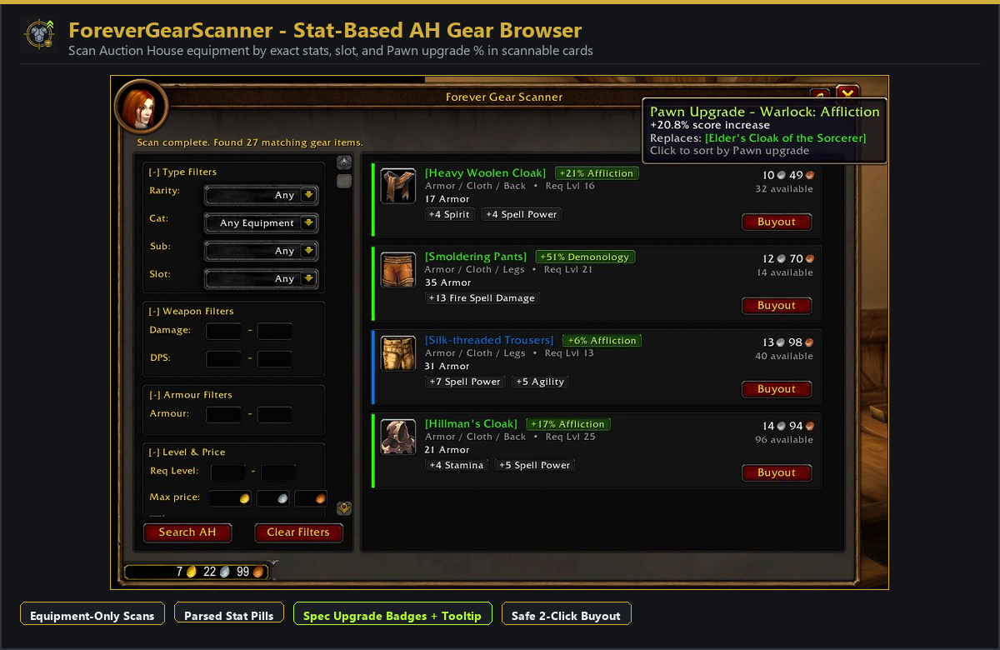

  

# ForeverGearScanner

A stat-based Auction House gear browser for **World of Warcraft: Forever** (`Interface: 16001`). Instead of clicking through endless AH pages and hovering tooltips one by one, filter directly by gear stats, slot, max price, and Pawn upgrades - displayed in clean, scannable gear cards.

## Key Features

- **Equipment-only scanning:** Browse queries target equipable **Weapon** and **Armor** items directly on Blizzard's `C_AuctionHouse` API - no consumables, trade goods, or bags in your results.
- **Granular slot & weapon/armor filters:** Narrow by Rarity, Weapon/Armor category, Subtype, Slot (including direct **Held in Off-Hand** filtering), Weapon Damage / DPS, Armor, and Required Level.
- **Multi-stat filtering with min/max values:** Filter by `Spell Power`, `Healing`, school damage (`Fire`, `Frost`, `Shadow`, `Nature`, `Arcane`, `Holy`), `MP5`, `Crit`, `Hit`, `Haste`, `Expertise`, `Defense`, `Block Value`, and more. Click an empty stat box to browse all 36 supported stats or type to filter live.
- **Built for WoW: Forever stat wording:** Accurately parses raw base stats alongside Classic/Forever `Equip:` text (including split healing + spell damage gear).
- **Native Gold / Silver / Copper max price:** Set your exact budget ceiling cleanly with separate numeric G/S/C boxes.
- **Instant unusable gear warnings:** Items you cannot equip tint soft red on the icon and highlight the failing requirement (proficiency, level, or class lock) on the card.
- **Throttle-safe AH queue & safe 2-click buyout:** Respects `IsThrottledMessageSystemReady()` automatically. Clicking **Buyout** verifies the cheapest live auction first and switches to **Confirm Buy** - your second click confirms purchase under hardware-event rules (`#hwevent`).

## Screenshots

## Optional Integration: Pawn by Vger

ForeverGearScanner works completely standalone, and becomes even better if you install **[Pawn](https://www.curseforge.com/wow/addons/pawn)** by **Vger**.

Pawn is one of the cleanest gear-evaluation addons ever built for WoW, and integrating it was an easy decision - rather than reinventing custom stat weights poorly, ForeverGearScanner lets Pawn do what it already excels at and surfaces those upgrade percentages directly on your AH search cards:

- **Upgrade badges on every card:** Instantly see the highest percentage upgrade and which spec wants the item.
- **Spec selector:** Focus `Pawn Upgrades Only` and **Sort by Pawn %** on one specific spec (for example `Affliction`) instead of mixing in off-spec results, or leave it on `Any (Best)`.
- **Full item comparison tooltip:** Hover over a Pawn badge to view the upgrade percentage and the exact item it replaces.
- **Zero hard dependency:** If Pawn is not installed, Pawn controls stay hidden and ForeverGearScanner works normally.

## Quick Start

1. Open any Auction House in-game and click the **Gear Scanner** tab (or type `/fgs` or `/gearscanner` at the AH).
2. Choose **Rarity**, **Cat** (`Weapon` / `Armor`), **Sub**, and **Slot**, plus optional **Req Level**, **Max price** (gold / silver / copper), **Usable Only**, or **Pawn Upgrades Only**.
3. Click **+ Add Stat Filter**, pick a stat from the dropdown, and enter optional Min/Max values.
4. Click **Search AH**.
5. Click **Buyout** on a card to verify the live listing, then click **Confirm Buy** to purchase.

## License

Released under the [MIT License](LICENSE).
